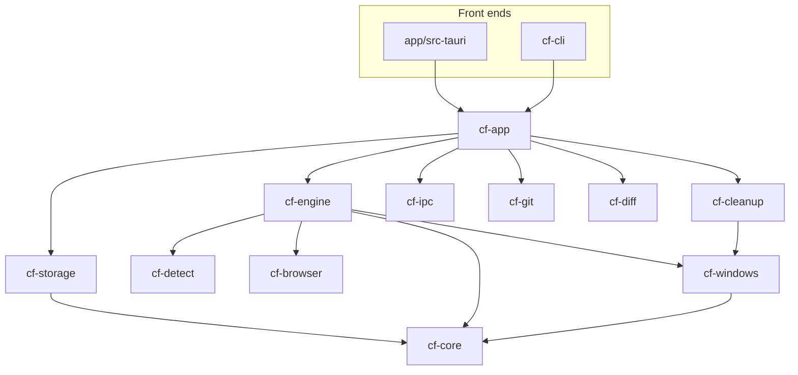
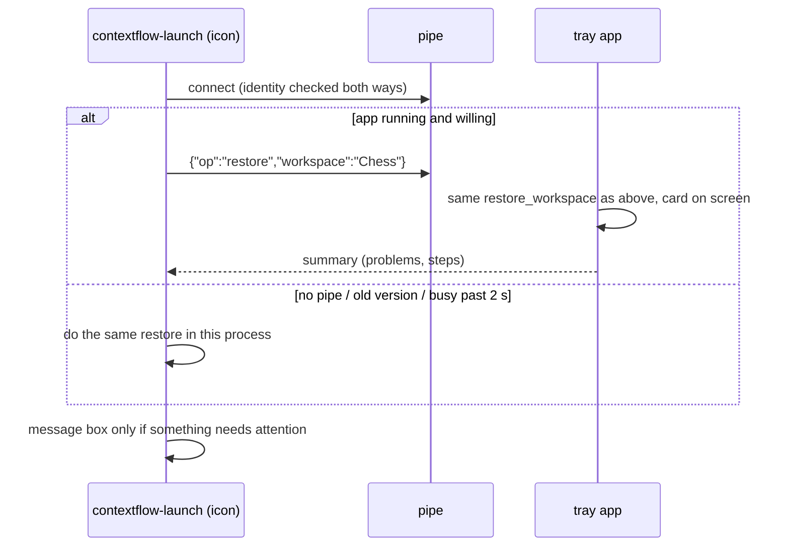

# ContextFlow — Software Architecture Document

This document explains **how ContextFlow works today**: what each part does,
how data moves between the parts, what happens in the background during a
switch, and **why** it was built that way. It is meant for someone who wants
to understand the system well enough to change it or to suggest a better
design.

It complements two other documents:

| Document | What it is for |
|---|---|
| `docs/SOFTWARE_ARCHITECTURE.md` (this one) | How the system works, and why. A reference. |
| `docs/ARCHITECTURE.md` | The short version: how it is built, what the November 2026 plan changed. Read it first. |
| `docs/ROADMAP.md` | What is left to do, improvements in order, ideas, and what was turned down. |
| `docs/COMMANDS.md` | Every command and option. |
| `docs/AGENT.md` | The pipe protocol and its security checks in full detail. |

**How to read it.** Each section starts with the idea in plain words, then
the technical detail. Three kinds of boxes appear throughout:

> **Why.** The reason for a decision.

> **Trade-off.** What the decision costs.

> **Could be better.** A known weakness or a concrete improvement. These are
> collected again in section 12.

Numbers are marked as **measured** (timed on a real desktop), **constant**
(a value written in the code) or **estimate**.

---

## Contents

1. Goals
2. Core concepts
3. Architectural principles
4. System components
5. Data flow
6. Workspace switch algorithm
7. Snapshot model
8. Restore model
9. Persistence layer
10. Failure recovery
11. Performance characteristics
12. Future evolution
13. Security and privacy
14. Appendix: where to find things

---

## 1. Goals

### 1.1 The one thing it must do

> Press one key and your whole desk changes: the apps, windows, browser tabs
> and project folders of the work you are switching to come back exactly
> where they were, and the work you left is saved for later.

Everything in the system either serves that sentence or supports it
(storage, safety, diagnostics).

### 1.2 Quality goals, in priority order

When two goals conflict, the higher one wins.

| # | Goal | What it means in practice |
|---|---|---|
| 1 | **Never embarrass the user** | Nothing opens twice. Nothing the user was working on is lost. Nothing is closed without a rule the user wrote. Anything that didn't come back is named. |
| 2 | **Correct over clever** | When the system is not sure (two folders with the same name, two equally recent solutions), it does nothing and says so, rather than guessing. |
| 3 | **Fast, and visibly so** | Windows that can be placed now are placed now; progress is shown as it happens. |
| 4 | **Local-first and private** | No server, no account, no network calls. Data stays in files on this computer. |
| 5 | **Simple to keep working** | Fewer programs, fewer crates, one place for each decision. |

> **Why this order.** A workspace switcher is trusted with the user's desk.
> One duplicated window or one lost tab undoes the trust that many fast
> switches built. So safety is ranked above speed.

### 1.3 Non-goals

* macOS and Linux. The window, process and pipe code is Windows-only.
* Restoring the *inside* of arbitrary apps (unsaved documents, scroll
  position). Only apps with a known adapter (browsers, editors, Explorer)
  get their contents back; other apps get their windows back.
* Cloud sync or multi-device.
* Changing anything in Git repositories. Git is read-only.

---

## 2. Core concepts

A short glossary. These words are used precisely in the rest of the
document.

| Term | Meaning |
|---|---|
| **Workspace** (in code: *context*) | A named set of work, such as "Uni" or "Chess". It has an id, a name, and a history of snapshots. |
| **Snapshot** | An immutable record of a workspace at one moment: which apps, where their windows were, which tabs and folders, notes, and optionally Git state. |
| **Version** | Snapshots of a workspace are numbered v1, v2, v3 … Numbers are never reused, even after a deletion. |
| **Payload** | The content of a snapshot (everything except its id, number and time). The payload is what is hashed and stored. |
| **Application** | One program in a snapshot, identified by its lower-case executable name: `code`, `chrome`, `devenv`. |
| **Window** | One top-level window of an application, with its title, rectangle, screen and state (normal, maximized, minimized). |
| **Adapter state** | Extra, application-specific data attached to an application: a browser's tabs, VS Code's folders, a Visual Studio solution. |
| **Active workspace** | The workspace you are "in" right now. At most one. Remembered in the database. |
| **Capture** | Looking at the desktop and turning it into a payload. |
| **Restore** | Making the desktop match a snapshot. |
| **Switch** | Save the active workspace, leave it, then restore another one and make it active. A restore of a workspace you are not in is always a switch. |
| **Auto-save** | The snapshot a switch saves of the workspace you leave. Marked `auto` so retention treats it separately. |
| **Checkpoint** | An auto-save taken quietly every 20 minutes (by default) while you work, so a crash or restart loses little. |
| **Cleanup rules** ("Focus rules" in the app) | Per-workspace lists of programs to close when you enter or leave it. |
| **Start and stop commands** | Per-workspace commands run when you enter or leave it, such as a dev server. |
| **Pin** | Make restore always use one particular version instead of the newest. |
| **Save mode** | Per workspace: `auto` (save on leaving), `notify` (save and say so), `fixed` (never save automatically). |
| **Trust** | Workspaces imported from a file cannot be restored until the user approves them, because they could name any program to start. |
| **Park / resume** | Put the current workspace aside on a small stack, deal with an interruption, then come back with one action. |
| **Front end** | A program the user drives: the desktop app, the CLI, the desktop icon. |

---

## 3. Architectural principles

Each principle is stated, then justified.

### P1. Local-first: files on this computer, nothing else

All state is in one SQLite file, one TOML config file, and a folder of small
JSON files written by the browser helper. There is no server and no network
code.

> **Why.** Privacy (window titles, tab addresses and folder paths are
> personal), zero setup, and nothing to break when offline.
>
> **Trade-off.** No sync between computers, and backups are the user's job
> (the app offers one-click backups and checks their age).

### P2. Snapshots are immutable and versioned

A snapshot is never edited. "Saving again" creates a new version. Deleting
is allowed only for retention and explicit user deletion.

> **Why.** It makes history trustworthy: v5 today is the same as v5 last
> week, which is what makes "go back to how it was" and `diff` meaningful.
> It also means a bad capture can never overwrite a good one; it only adds a
> newer version, and pinning or restoring an older one is always possible.
> The database enforces this with a trigger, not just the code (section 9).
>
> **Trade-off.** Storage grows; retention rules are needed (section 9.6).

### P3. One source of truth per fact

The hashed payload JSON is the only copy of a snapshot's content. Earlier
versions also wrote "projection" tables (one row per window, per app); they
were never read, so migration 6 dropped them.

> **Why.** Two copies of the same data drift apart. A single canonical
> payload can be re-hashed at any time to prove it hasn't changed.

### P4. Layers, and each layer talks only to the one below

```
 FRONT ENDS     desktop app (tray + windows)   contextflow (CLI)   desktop icon (contextflow-launch)
                         \                            |                      /
 SERVICES                 cf-app: capture, switch, auto-save, park, search, health, pipe handler
                                                      |
 ENGINE                   cf-engine: start apps, wait for windows, place them, report per app
                          cf-cleanup: close the programs a workspace doesn't want
                          cf-detect, cf-browser, cf-git: what is open inside apps
                                                      |
 FOUNDATION               cf-core (model, hashing)  cf-storage (SQLite)  cf-windows (Win32)
                          cf-config  cf-diff  cf-ipc (pipe)
```

> **Why.** The engine can be tested against a fake desktop because it only
> sees a `Desktop` trait, not Win32. The services can be shared by three
> front ends because none of them is in the services. A change in one layer
> rarely touches another.

### P5. Front ends are thin; behaviour lives in `cf-app`

If the app and the CLI need the same behaviour, it is written once in
`cf-app`. Restore settings, for example, are built by one function,
`RestoreArgs::new`, which all three front ends call.

> **Why.** Three copies of one decision is how "it works in the CLI but not
> in the app" bugs are born.

### P6. Never guess

Whenever a match is ambiguous (two folders called `backend`, two equally
recent solutions, a browser window whose title matches two live windows),
the code chooses nothing and reports it.

> **Why.** A wrong guess opens the wrong project in front of the user, which
> is worse than opening nothing and saying why (goal 1).

### P7. Safe by construction

* Only absolute paths to `.exe` files are ever started; never a shell, never
  a script, never elevated.
* Command-line arguments that come from saved state are checked before use
  (a folder address must be `file:///…`, a path must be a plain absolute
  path, never something that looks like a switch).
* A program is closed only if the user listed it in a cleanup rule. Closing
  asks first ("close nicely"); ending it by force is a separate opt-in per
  program. A list of Windows programs (Explorer, `dwm`, `lsass` …) and
  ContextFlow itself can never be closed.
* Imported workspaces cannot run until approved.

> **Why.** A snapshot is data that turns into process launches. Anything
> that can be launched from data must be treated as untrusted input.

### P8. Every application gets an explicit result

A restore reports a status per application: `success`, `partial_success`,
`failed`, `skipped` or `requires_user_intervention`, each with a stable code
such as `EXE_NOT_FOUND` or `WINDOW_TIMEOUT`.

> **Why.** "Something went wrong" is useless. "Discord was not found; is it
> still installed?" is actionable. Stable codes also let the UI and history
> treat failures consistently.

### P9. Everything is bounded

Every wait has a limit: per-app window wait (30 s), whole restore (120 s),
Git inspection (10 s), closing a program (6 s), message sizes (1 MiB pipe
frames, 2 MiB adapter state).

> **Why.** A switch that can hang forever is worse than one that finishes
> with "3 of 7 need attention".

### P10. Measure before optimising

Every switch records where its time went (section 11). Speed changes are
justified by those numbers.

---

## 4. System components

### 4.1 Programs (processes)

| Program | Kind | Started by | Job |
|---|---|---|---|
| `contextflow-app.exe` | Tauri desktop app with a tray icon | The user, or Windows at sign-in (opt-in) | The main UI; global shortcuts; the checkpoint timer; restart recovery; **serves the pipe** for the icon and CLI. |
| `contextflow.exe` | Command-line program | The user, in a terminal | Every operation, scriptable. |
| `contextflow-launch.exe` | Windowless program | A desktop icon (double-click) | One switch, then a message box only if something needs attention. |
| `contextflow-browser-host.exe` | Native-messaging host | Chrome or Edge, automatically | Receives the tab list from the extension and writes it to a file. |
| Browser extension | JavaScript (Manifest V3) | Chrome or Edge | Sends open windows and tabs to the host. |

> **Why one background program.** The tray app already runs all the time,
> owns the shortcuts and the timers, and starts with Windows. An earlier
> design had a second always-on program (`contextflow-agent`) just for the
> pipe; it was folded into the tray app to remove a moving part.
>
> **Trade-off.** The tray app holds a WebView runtime, so it uses more
> memory than a bare background program would. To keep that small, its
> windows are *closed* (not hidden) when you close them, and nothing is
> created at sign-in until needed.

### 4.2 Crates (Rust packages)

About 26,900 lines of Rust in 14 packages, plus about 5,500 lines of
TypeScript/React UI. 346 automated tests.

| Crate | Lines | Responsibility | Depends on (main) |
|---|---|---|---|
| `cf-core` | 1,133 | Data model, canonical hashing, validation, placement geometry. No I/O. | — |
| `cf-storage` | 2,637 | SQLite: schema, migrations, snapshots, history, timeline, retention, export/import. | cf-core |
| `cf-config` | 585 | `config.toml`: load, validate, defaults. | — |
| `cf-windows` | 1,049 | Win32: list windows and monitors, start processes, move windows, the named mutex, process tree. | cf-core |
| `cf-git` | 242 | Read-only Git status with a timeout. | cf-core |
| `cf-diff` | 583 | Deterministic comparison of two payloads. | cf-core |
| `cf-ipc` | 1,932 | The per-user named pipe: protocol, framing, access checks, client and server. | — |
| `cf-browser` | 1,393 | The extension protocol, the native-messaging host, live tab files, matching tabs to windows, install. | cf-core, cf-config |
| `cf-detect` | 1,557 | Which folder, solution or project each VS Code, Visual Studio, JetBrains and Explorer window has open. | — |
| `cf-cleanup` | 932 | Running programs with memory/CPU, the protected list, close and force-close. | cf-windows |
| `cf-engine` | 3,593 | The restore pipeline: plan, launch, wait, place, report. | cf-core, cf-windows, cf-browser, cf-detect |
| `cf-app` | 3,923 | Services shared by all front ends: capture, switch, auto-save, park, search, health, shortcuts, the pipe handler. | everything above |
| `cf-cli` | 2,407 | `contextflow`, `contextflow-launch`, `contextflow-browser-host`. | cf-app |
| `app/src-tauri` | 4,962 | The desktop app's backend: Tauri commands, tray, shortcuts, windows, the pipe server thread. | cf-app |



### 4.3 How the programs talk to each other

There are exactly four channels, and each has one job.

| Channel | Between | Carries | Why this mechanism |
|---|---|---|---|
| **SQLite file** (`contextflow.db`) | Every program | All persistent state | One file, transactional, safe for several processes at once (WAL mode). |
| **Named pipe** `\\.\pipe\ContextFlow.Agent.<SID>.<session>` | Icon and CLI → tray app | "Switch to X", "leave", and the result | Lets a short-lived program hand its work to the long-lived one. Per user and per login session. |
| **Named mutex** `Local\ContextFlow.Restore` | Whoever restores | "A restore is running" | The OS releases it if the holder crashes, so it can never get stuck. |
| **Live tab files** (`…\data\browser\live\<browser>-<profile>.json`) | Browser host → capture/restore | Open windows and tabs | The host is started by the browser and is separate from ContextFlow; a file is the simplest hand-over between unrelated processes. |

Plus one inside the browser: **Native Messaging** (stdin/stdout, 4-byte
length + JSON) between the extension and the host. That is Chrome's own
mechanism for an extension to talk to a local program.

---

## 5. Data flow

### 5.1 Capture: desktop → snapshot

```mermaid
sequenceDiagram
  participant U as User / timer
  participant A as cf-app capture
  participant W as cf-windows
  participant B as live tab files
  participant D as cf-detect
  participant S as cf-storage
  U->>A: capture "Uni"
  A->>W: list monitors, list windows (top to bottom)
  W-->>A: windows with exe path, title, rect, state
  A->>A: group windows by application, drop excluded ones
  A->>B: read live tabs for each browser
  A->>A: match browser windows to live windows (title, then position)
  A->>D: for each editor/Explorer: titles → folder/solution/project
  A->>A: optional Git status; replace private titles with "(hidden)"
  A->>S: validate, canonical JSON, SHA-256, insert as next version
```

Step by step:

1. **Monitors and windows** are read from Win32. Only user-facing top-level
   windows are kept: visible, not owned by another window, not cloaked
   (that is, not on another virtual desktop), with a title, and not the
   desktop itself. Windows come back in **z-order, top first**, and that
   order is kept in the payload.
2. **Grouping.** Each window's executable gives an application id
   (`C:\…\Code.exe` → `code`). A few system processes are always skipped
   (Start menu, search, the lock screen, ContextFlow itself), plus any the
   user excluded. Windows whose title matches an exclusion pattern are
   dropped.
3. **How to start it later** is decided now:
   * Microsoft Store apps get their package id (AUMID) saved, because their
     install folder changes with every update.
   * A window owned by a helper process (Steam's `steamwebhelper.exe`) is
     saved with the program that started it, found by walking the process
     tree.
4. **Browser tabs.** For Chrome and Edge, the live tab file written by the
   extension is read, and each live browser window is matched to a desktop
   window by title (and by position when two titles are the same).
5. **Folders, solutions, projects** (`cf-detect`): the window title gives a
   name, the name is looked up in the app's own recent list, and the path is
   kept. Section 7.4 explains this.
6. **Privacy pass.** Titles matching "hidden" patterns are replaced with
   `(hidden)`, including inside adapter state. This happens last because the
   steps above match by title.
7. **Store.** The payload is validated, encoded as canonical JSON, hashed,
   and inserted as the next version (section 7).

### 5.2 Switch: from a key press to a ready desk

```mermaid
sequenceDiagram
  participant K as Ctrl+Alt+W
  participant UI as switcher window
  participant APP as tray app
  participant SES as cf-app session
  participant ENG as cf-engine
  K->>APP: global shortcut
  APP->>UI: build and show the picker
  UI->>APP: quick_switch("Chess")
  APP->>SES: restore_workspace (on a worker thread)
  SES->>SES: find, check trust, pick version, verify hash, take lock
  SES->>SES: save the workspace you're leaving (auto-save)
  SES->>SES: its stop commands, then cleanup rules
  SES->>ENG: restore(payload)
  ENG-->>APP: progress lines ("code is back (3 of 7)")
  APP-->>K: on-screen card updates
  ENG-->>SES: per-app results, timings
  SES->>SES: record history; mark "Chess" active; start commands
  SES-->>APP: outcome
  APP-->>K: card: "“Chess” is ready · 7 apps · 2.1 s"
```

### 5.3 Desktop icon and CLI: handing work to the running app



> **Why hand the work over at all.** The tray app shows progress on screen
> and keeps one long-lived database connection. More importantly, routing
> every switch through one process is the base for future work such as a
> live model of the desktop (section 12).
>
> **Why the fallback.** The icon must work when the app isn't running. Both
> paths call the same function, `cf_app::service::handle`, so they give the
> same result.
>
> **Why no retry after sending.** Once a "restore" request has been written,
> a lost reply is reported as an error, never retried locally. The work may
> already be half done; doing it again could open things twice.

### 5.4 Browser tabs: from the extension to a snapshot

```
Chrome/Edge extension ──(native messaging: length + JSON)──▶ contextflow-browser-host.exe
   every change (debounced 0.8 s)                               validates, then writes
   and every 20 s (heartbeat)                                   live/<browser>-<profile>.json  (atomic: temp + rename)
                                                                deletes the file when the browser disconnects
capture ──▶ reads files younger than 120 s ──▶ matches live windows to desktop windows ──▶ tabs into adapter state
```

> **Why files, not a pipe to ContextFlow.** The browser starts the host on
> its own schedule; ContextFlow may not be running. A file written
> atomically is always readable, needs no connection, and goes stale safely
> (files older than 120 s are ignored, so a crashed browser's tabs are never
> mistaken for open ones).
>
> **Why restore needs no extension.** Reopening uses the browser's own
> command line (`chrome.exe --new-window <url> <url> …`). The extension is
> only needed to *read* tabs, to avoid opening tabs that are already open,
> and to pin tabs again (below).

**The one message back: pin requests.** The command line can open tabs but
not pin them. So just before restore opens a window, it leaves a small file
for each window whose reopened tabs included pinned ones:

```
restore ──▶ browser/requests/pin-<id>.json ──▶ every running host (checks every 250 ms)
            { browser, urls, created_at }        passes each request on once ──▶ extension
                                                 extension of that browser pins one unpinned
                                                 tab per address, in the saved order
```

> **Why it is safe to pin by address.** Restore reopens only tabs that are not
> open already, so an unpinned tab with a requested address is the one it just
> opened, never one of the user's own. Requests are tried for 60 s (tabs may
> still be loading, and a cold browser connects its extension a few seconds
> after starting), then expire; hosts delete expired files. Each request is
> passed on at most once per host and applied at most once by the extension.
>
> **Trade-off.** It is best effort. Without the extension, or with an older
> one, tabs reopen unpinned, as before, and nothing reports it. If a site
> redirects to a different address before the extension looks, that tab stays
> unpinned. Every host of the browser passes the request on (one per profile),
> because nothing tells which profile opened the window; only the one that
> has the tabs finds anything to pin.

---

## 6. Workspace switch algorithm

This is the heart of the system: `cf_app::session::restore_workspace`
(services) followed by `cf_engine::restore` (engine).

### 6.1 Services: preparing, leaving, entering

```text
restore_workspace(workspace, args):
  ── prepare ──────────────────────────────────────────────────────────
  ctx       ← find workspace by name or id
  refuse unless trusted (imported workspaces need approval); dry runs always allowed
  version   ← args.version, else the pinned version,
              else the newest snapshot saved with the screens connected now,
              else the newest
  snapshot  ← load; refuse if its hash no longer matches (tampered/corrupt)
  lock      ← try to take Local\ContextFlow.Restore; if taken → "busy"
  ── save (only a real switch) ────────────────────────────────────────
  left      ← auto-save the active workspace (section 6.3)
  ── stop ─────────────────────────────────────────────────────────────
  run the stop commands of the workspace being left
  keep      ← apps in the target snapshot + "always-on" apps
  jobs      ← the leaving workspace's "when leaving" rules, then the
              target's "when entering" rules (each except `keep`)
  ── restore, with the cleanup alongside ──────────────────────────────
  on another thread: close the programs of each job, one job after the other
                     (within a job, all are asked at once and waited for
                     together; see the notes below)
  meanwhile:  run  ← cf_engine::restore(snapshot)   (section 6.2)
  wait for the cleanup thread (zero if it already finished)
  ── finish ───────────────────────────────────────────────────────────
  record the run (per-app steps + per-phase timings) in history
  if anything came back: mark target active, run its start commands
  else if we left a workspace: mark none active
  add a timeline entry (switch or restore)
```

> **Why save before closing anything.** Cleanup may close programs of the
> workspace you are leaving; the save must see them first.
>
> **Why verify the hash before restoring.** A snapshot turns into process
> launches. If the stored bytes changed (disk error, manual edit), it is
> refused rather than acted on.
>
> **Why `keep`.** Programs the target workspace needs are never closed by
> cleanup, even if a rule names them, so a switch never closes something
> only to start it again.
>
> **Why the cleanup runs alongside the restore.** Closing a program can take
> up to 6 s when it hides to the tray or asks to save. Done before the
> restore, the user would stare at the old desk for that long before
> anything of the new one appeared. Run on its own thread at the same time,
> the new desk starts immediately and the old programs close behind it. It
> is safe because everything the cleanup may close was decided beforehand
> (`keep` is fixed), the save and the stop commands have already happened,
> and the restore only touches programs of the target snapshot, which are
> never in the cleanup's reach. The report waits for the cleanup to finish,
> so its results are still part of it; the time spent waiting after the desk
> was ready is shown as the `cleanup` phase.
>
> **Trade-off.** Memory held by the old programs is not freed before the new
> ones start, so on a very full machine the first moments of a switch can be
> a little slower. Closing and starting also compete a little for the disk
> and processor. For a switch with no cleanup rules, nothing changes.
>
> **Why cleanup asks everything at once.** Closing a program is "ask, then
> wait up to 6 s for it to exit". Many apps (Discord, Steam, chat and game
> launchers) answer by hiding to the tray, so they never exit and the wait
> always runs out. Done one program at a time, three such rules cost 18 s.
> Now every program is asked first and all are waited for together, so the
> wait is 6 s however many there are. The outcomes, the order of the results
> and every safety check are unchanged; programs that need ending by force
> are ended together, too.
>
> **One look at the system per cleanup.** The running programs are listed
> once at the start (path, session and which programs run ContextFlow
> itself), not again for every rule. While waiting, only the ids of running
> processes are read, which needs no process to be opened: measured on a
> machine with 338 processes, 6 ms against 15 ms for the full listing, every
> quarter second for up to 6 s.
>
> **A program with a dialog open is never force-ended.** Force mode ends a
> program that ignores the close request. A program that answered the request
> with "Save changes?" is also still running, and ending it would lose exactly
> the work the user would have saved. So before ending anything, the program's
> windows are checked for a dialog (a visible popup of a window, or a standard
> Windows dialog box); if one is open, the program is left alone and reported
> as still running, with the reason. A hung program has no such dialog and is
> still ended, which is what force mode is for. Limit: apps that draw their own
> prompt inside the window (Electron apps, for instance) can't be recognised
> this way, so force mode can still end them; the app warns about that.
>
> **The two cleanups run together.** The "leaving" and "entering" cleanups are
> independent, so each runs on its own thread and the results keep their order
> (leaving first). A program named by both is closed by the first only, so it
> is never asked twice or ended after it has already gone. With stubborn
> programs on both sides the wait is one 6 s, not two.
>
> **Why "only if anything came back".** A switch where every app failed
> should not claim you are now in that workspace; the next switch would
> otherwise auto-save an empty desk over it.

### 6.2 Engine: the staged restore

The engine fills the desk in stages, most important application first
within each stage. **Importance** is the saved z-order: the application whose
window was on top when the snapshot was taken comes first.

```text
cf_engine::restore(payload):
  monitors, windows_now ← scan the desktop once
  for each app, in importance order:                     (no side effects)
      running?        ← any current window with the same app id
      if not running: plan how to start it, or record why it can't be
      classify into one of:
        A. running, nothing to add            → place now
        B. not running, ordinary app          → start, place when it shows, again when settled
        C. running browser/editor with tabs/folders → add what's missing, place
        D. not running browser/editor with tabs/folders → open each saved window
  stage 1: place every A                                   (instant)
  stage 2: start every B, without waiting
  stage 3: for each C: open missing tabs/folders, then place its windows
  stage 4: for each D: open its saved windows one by one
           (each window placed the moment it appears, then once more ~0.75 s later;
            while waiting for a window, place any B that has shown or settled)
  stage 5: until every B is settled and every recheck done: poll, place
  report per app, in the snapshot's order; timings per phase; first-window time
```

Why each stage is where it is:

| Stage | Why here |
|---|---|
| 1. Running apps first | They need no waiting at all. Placing them first means the desk visibly starts changing within milliseconds. |
| 2. Start everything at once | Apps take seconds to start, mostly in parallel. Starting them all before waiting for any means total time ≈ slowest app, not the sum. |
| 3. Running browsers/editors | They only need missing tabs or folders added. Their existing windows are placed **after** the new ones, so an existing window never takes the saved position of a window that was just reopened. |
| 4. Browsers/editors not running | Opening their windows is the slowest part (each window has to appear before the next is opened), so it goes last, and other apps are placed *during* those waits. |
| 5. The rest | Whatever is still starting. |

**Place early, confirm later.** A started app's windows are put in place as
soon as its first window shows, so the desk changes without delay. The app is
**settled** once the number of its windows hasn't changed for `settle` (1.5 s,
constant); its windows are then placed again, and only then is it reported.

> **Why place twice.** Apps often open a splash screen, then the real
> window, then a second one. Placing only once, early, could move the splash
> screen and miss the real window; placing only once, late, keeps the user
> waiting 1.5 s for nothing. Placing early and again at the end gives both:
> the window moves at once, and the final placement uses the windows that
> stayed.
>
> **Trade-off.** If the early placement paired a saved position with a
> splash screen, the real window jumps into place a moment later instead of
> appearing there directly.

**Polling** starts at 25 ms and doubles up to 500 ms (constant).

> **Why polling and not events.** Windows has event hooks for window
> creation (`SetWinEventHook`), but polling is simpler, easy to fake in tests,
> and costs little: one window scan takes about 65 ms for a whole program
> start and much less inside a running one (measured, section 11).
>
> **Could be better.** An event-driven model would place windows the moment
> they appear and remove the poll delay. See section 12.

### 6.3 Auto-save rules (`cf_app::autosave`)

The workspace you leave is captured, then saved **only if it is worth it**:

| Case | Result | Why |
|---|---|---|
| Saving on switch is off, the workspace is archived, or its save mode is `fixed` | Not saved | The user said so. |
| None of the programs it saved last time are open | Not saved | An emptied desk must never overwrite the last good layout with an empty one. |
| Layout identical to the newest snapshot | Not saved | Switching back and forth shouldn't fill history with copies. "Identical" ignores window titles and capture metadata, which change constantly. |
| You wrote a new leaving note | Saved even if unchanged | The note is new information. |
| Otherwise | Saved as an `auto` snapshot, then retention runs | |

### 6.4 Concurrency

* **One restore at a time per login session**, whoever starts it. The named
  mutex `Local\ContextFlow.Restore` is taken with "try", not "wait": a
  second restore gets `busy` immediately (a second double-click does nothing).
* Inside the tray app, its own switches and pipe-served switches share the
  same mutex, so they can't overlap either.
* The desktop app also keeps a "restore in progress" slot so the UI can
  offer Cancel. Cancel sets a flag the engine checks between steps;
  programs already started are left running.

> **Why a named mutex, not a lock file.** The kernel owns it and frees it if
> the process dies. A stale lock file after a crash would block every future
> switch.

---

## 7. Snapshot model

### 7.1 The payload

```text
SnapshotPayload {
  schema_version: 1
  applications: [ ApplicationState {
      application_id      "code"
      executable_path     "C:\…\Code.exe"
      launch_arguments    []
      working_directory   None
      adapter_id          "vscode" | "browser" | "visualstudio" | "explorer" | "jetbrains" | "packaged-app" | None
      adapter_state       JSON owned by that adapter
  } ]
  windows: [ WindowState {               ← in z-order, top first
      application_id, title, window_class, monitor_id,
      rect {x,y,width,height} (physical pixels), display_state
  } ]
  monitors: [ MonitorInfo { id, primary, rect, work_area, dpi } ]
  git:      [ GitState { path, branch, head, staged, modified, untracked, … } ]
  notes:    [ "finish the migration test" ]
  metadata: { contextflow_version }
}
```

What is deliberately **not** stored:

* **Window handles** (`HWND`). They are temporary OS references, invalid
  after a restart. Windows are found again by application and title.
* **Credentials, cookies, page content, history.** The extension never reads
  them, and nothing else could.
* **Start and stop commands** are stored on the workspace, not in snapshots,
  and are never exported.

### 7.2 Canonical JSON and the hash

The payload is turned into **canonical JSON**: object keys sorted at every
level, no whitespace. The SHA-256 of those bytes is the snapshot's hash. The
canonical bytes are what is stored.

> **Why canonical.** The same content must always produce the same bytes,
> whatever order a struct's fields or a map's entries happened to be in.
> Otherwise "same layout" checks and integrity checks would give false
> alarms.
>
> **Why store the canonical bytes, not re-serialise.** Verifying a snapshot
> is then just "hash the stored bytes and compare", with no dependency on
> how today's code would serialise it. Old snapshots stay verifiable after
> any code change.
>
> **Why nothing volatile is in the payload.** Only facts about the content
> go in: the same desk must give the same hash. Snapshots saved before
> November 2026 also hold `capture_duration_ms`, which differed on every
> capture; new ones don't (the capture time goes to the log instead). Old
> snapshots keep it, since snapshots are never changed, so an old and a new
> capture of the same desk still hash differently once.

### 7.3 Versions, origin, immutability

* Versions come from a per-workspace counter (`contexts.last_version`),
  incremented inside an `IMMEDIATE` transaction. Deleting v7 never lets a
  later snapshot reuse "v7".
* Each snapshot records its **origin**: `manual` (Capture, quick capture,
  CLI) or `auto` (switch, leave, checkpoint).
* A database trigger aborts any `UPDATE` of a snapshot row.

> **Why a counter, not `MAX(version)+1`.** With `MAX`, deleting the newest
> version and saving again would create a second, different "v7". Anything
> that referred to v7 (a pin, an export, a note) would silently point to new
> content.
>
> **Why `IMMEDIATE`.** It takes the write lock at the start of the
> transaction, so two programs saving at the same moment can't both read
> the same counter value.
>
> **Why a trigger.** Immutability enforced only in Rust can be broken by any
> future code path; a trigger protects the data from all of them.

### 7.4 Adapter state: the extension point

`adapter_id` + `adapter_state` is how the payload grows without changing
its schema. Each adapter owns its JSON, with its own `schema_version`.

| adapter_id | Written by | Holds |
|---|---|---|
| `browser` | capture, from the live tab files | windows → tabs (url, title, pinned), the active tab |
| `vscode`, `visualstudio`, `explorer`, `jetbrains` | `cf-detect` | windows → name from title, path to reopen |
| `packaged-app` | capture | the Store app's AUMID |

`cf-detect` uses **one routine for all four** apps, driven by a small table:

```text
for each window title:
   (name, path_in_title) ← app.parse_title(title)
   if path_in_title is safe and exists → use it
   else candidates ← app's own recent list, filtered by name, safe, existing, unused
        sort by rank (most recently used, or listed first)
        if the best two tie → nothing (never guess)
        else take the best
```

| App | Title example | Where its list comes from | Reopened with |
|---|---|---|---|
| VS Code | `main.rs - ContextFlow - Visual Studio Code` | `%APPDATA%\Code\User\globalStorage\storage.json` | `code --new-window --folder-uri file:///…` |
| Visual Studio | `CorpusAudit - README.md - Microsoft Visual Studio` | `ApplicationPrivateSettings.xml` of each installed version | `devenv.exe <path>` |
| JetBrains | `HelloWorld – main.py` | `%APPDATA%\JetBrains\<IDE>\options\recentProjects.xml` | `<ide>64.exe <path>` |
| File Explorer | `Downloads - File Explorer` | The Windows Shell, asked directly over COM (`IShellWindows`), **by window handle** | `explorer.exe <path>` |

| Windows Terminal | whatever the shell last said (names no folder) | The terminal's own process: the shells running below the window, and the folder each is in | `wt.exe -w new -d <a> ; new-tab -d <b> …` |

**Windows Terminal reads processes, not titles.** The window's process is
asked which shells (PowerShell, cmd) run below it; the folder of each is read
from that process, and the first tab's goes in the window's `path`, the others
in `tabs`. Restore starts one new window per saved window with a tab per
folder, through the `wt.exe` alias (the Store app's own path can't be given
arguments). Windows can't be told apart by title, so a running terminal with
as many windows as were saved is taken to have them all.

> **Limits, stated plainly.** PowerShell does not change its process's folder
> when you `cd`, so for it the saved folder is where the tab *started*, which
> is the project folder for tabs opened by "Open in Terminal" or `wt -d`, and
> the home folder otherwise. `cmd` is read live. WSL and `bash` tabs are not
> saved (their Windows-side folder says nothing about the Linux folder), split
> panes come back as tabs, and two windows hosted by one terminal process
> can't be separated, so nothing is saved for them. Seeing the live folder of
> PowerShell would need a line in the user's PowerShell profile that reports
> it, which ContextFlow doesn't install.

**Explorer is the exception among the title-based apps: it is matched by window handle.** The Shell
lists each open folder together with the window it is in, so capture asks it
directly instead of reading titles. That works in every language (the title is
not needed for a window with one folder), tells apart two windows with the
same name, and copes with tabs: a window with several tabs gets the tab its
title names (`Downloads and 2 more tabs - File Explorer`), and if the title
names none or two, nothing is saved rather than a guess. Window handles are
only good while the window lives, so they are used during capture and never
saved.

> **Trade-off.** A window with several tabs is saved with its front tab only,
> and comes back as one ordinary window. Reopening the other tabs would need
> Explorer's own window commands, which can't be driven reliably. Whether all
> the tabs of a window report the same handle is what the Shell is documented
> to do and what the code relies on; it has not yet been checked against a
> real tabbed window.

> **Why window titles.** It needs no extension in any of these apps. The
> apps already keep lists of what they opened; the title says which one is
> on screen.
>
> **Trade-off.** Titles are the weakest link: they change with the open file,
> can be ambiguous, and differ between versions and languages. The "never
> guess" rule turns ambiguity into "not saved" rather than "wrong".
>
> **Why adapters reject unknown schema versions.** A newer ContextFlow may
> write a format an older one can't read correctly; the older one then
> treats the app as having no saved contents, instead of misreading them.

### 7.5 Validation before anything is stored

`cf_core::validate::payload` refuses: an unknown `schema_version`, empty
application ids or paths, NUL characters, window sizes over 100,000 px,
adapter state over 2 MiB per app, oversized notes. Names are trimmed, at
most 100 characters, with no control characters.

> **Why.** Corrupt or hostile data (an imported file) must be stopped at the
> door, not discovered half way through a restore.

---

## 8. Restore model

### 8.1 How an application is started

`plan_launch` decides, in this order:

1. A Store app window host (`ApplicationFrameHost`) → **skipped**, explained.
2. A Store app (path under `\WindowsApps\`) → start by its saved package id
   (AUMID), or look it up.
3. Not an absolute path to an `.exe` → **refused** (`UNSAFE_PATH`).
4. A known helper process → start the program it belongs to.
5. The saved path exists → start it.
6. An app that installs into `app-<version>` folders (Discord, Slack) and
   was updated → start the same program from the newest version folder.
7. Otherwise → `EXE_NOT_FOUND`, "is it still installed?"

> **Why step 6.** Squirrel-installed apps delete their old folder on update,
> so a snapshot from last month points to a path that no longer exists.
> Finding the newest sibling folder with the same program fixes the most
> common "it was installed, why didn't it start" failure.

### 8.2 "Nothing opens twice" (idempotency)

* An app with any window already open is **never started again**; its
  windows are only moved.
* A running browser only gets tabs whose address (normalised: lower-case
  host, no `#fragment`, no trailing slash) isn't already open. Without the
  extension, it can't tell what is open, so it adds nothing.
* A running editor only gets folders whose name isn't already in a window
  title.
* The restore mutex stops a second restore from starting at the same time.

> **Why so strict.** Running a switch twice (double-click, impatience) is
> normal behaviour; it must be harmless.

### 8.3 Pairing saved windows with real windows

When an app's windows are ready, saved windows are paired with open ones:

1. identical title first,
2. then the remaining ones in order.

Each pair is moved with one `SetWindowPlacement` call, which sets the
rectangle and the maximized or minimized state together.

### 8.4 Placement and changing screens

```text
choose the screen for a saved window:
  1. the screen it was saved on, if still connected
  2. else the screen it overlaps most
  3. else the primary screen
  4. else any screen
then shrink and shift the rectangle so it fits inside that screen's work area
```

> **Why "fit inside".** A window placed partly off-screen, or behind the
> taskbar, is lost to the user. Every restored window must be reachable.

**A different display layout.** The snapshot keeps the displays it was saved
on. At the start of a restore, each window is scaled by the ratio between the
work area it sat on and the one it goes to, so two windows saved side by side
on a large display stay side by side on a small one (and are then kept
on-screen as before). When the display is the same size, nothing is changed,
so the common case is exact. Trade-off: a window made to fit a smaller display
is not made larger again when the large display returns; the snapshot itself
is never modified, so restoring it there gives the original sizes.

**Stacking and focus.** The saved windows are stored top to bottom. When
everything is in place, the engine raises the windows from the bottom of that
stack to its top (a raise puts a window above the others without activating
it) and then gives the focus to the top one. Minimized windows are left out,
because raising one would bring it back up.

> **Why at the end.** Placing a window can bring it to the front, and apps
> that are still starting take the focus when their window appears. Left
> alone, the order the windows end up in is the order they were handled in,
> which is not the saved order, and the last app to start keeps the keyboard.
> One pass at the end fixes both, whatever happened before.
>
> **Trade-off.** Windows only lets the program the user is working in take
> the focus. A switch started from the picker, the icon or the terminal
> normally qualifies; when Windows refuses, the engine joins the input queue
> of the window in front for the moment of the call, and if that fails too,
> the stacking order is still rebuilt but the keyboard stays where it was.
> Windows of elevated programs can't be raised by a normal one.

And one level higher, **a layout per display setup**: when nothing picks a
version, restore uses the newest snapshot saved with the same screens (same
ids, sizes, arrangement and primary) among the last 20, so a workspace
captured once docked and once on the laptop has the right layout for each.

### 8.5 Browsers and editors

Each saved window that had tabs or a folder is opened on its own command
line. The new desktop window is identified as "the window of this app that
wasn't there a moment ago" and moved to its saved place **the moment it
appears**. The next window is opened straight away. Each new window is placed
**once more** about 0.75 s later (the `settle` time, at most 750 ms), while
other work carries on. Positions used by these windows are not handed out
again to the app's other windows.

> **Why the second placement.** Browsers and VS Code resize and move a new
> window themselves just after creating it, which can undo a placement made
> the instant it appeared. Earlier versions paused 750 ms before placing
> each window, one after another, which cost about 1.5 s on a two-window
> browser. Placing at once and again later costs one pause in total, at the
> end, and the window is where it belongs from the start.
>
> **Trade-off.** If the browser does move its window in between, the user
> sees it jump back. The second placement is "blind" (it doesn't check
> whether the window moved), because comparing positions reliably across
> screen scaling is fiddly, and placing a window where it already is changes
> nothing visible.

Limits: at most 50 tabs per window (configurable) and a command line under
28,000 characters (Windows' limit is 32,767).

**Pinned tabs** are asked for before their window opens (section 5.4), so the
request is waiting when a browser that is just starting connects its
extension.

### 8.6 Results and codes

| Status | Typical codes | Meaning |
|---|---|---|
| `success` | — | Started or already running, windows arranged. |
| `partial_success` | `FEWER_WINDOWS`, `TABS_PARTIAL`, `FOLDERS_PARTIAL` | Came back, but not completely. |
| `requires_user_intervention` | `ACCESS_DENIED` | Its windows belong to an elevated program and can't be moved by a normal one. |
| `failed` | `EXE_NOT_FOUND`, `UNSAFE_PATH`, `LAUNCH_FAILED`, `WINDOW_TIMEOUT`, `OUT_OF_TIME`, `PLACE_FAILED` | Didn't come back; the message says why. |
| `skipped` | `DRY_RUN`, `CANCELLED`, `UNSUPPORTED_APP` | Deliberately not done. |

The overall result is `failed` only if every app failed, `partial_success`
if any app needs attention, else `success`.

### 8.7 Dry run and cancel

* **Dry run** goes through the same planning and says what *would* happen
  ("already running; its windows would be repositioned"). It never starts,
  closes or moves anything, never saves, and needs no lock.
* **Cancel** stops new work; nothing started is closed.

---

## 9. Persistence layer

### 9.1 Where things live

| What | Where (default) |
|---|---|
| Database | `%APPDATA%\ContextFlow\ContextFlow\data\contextflow.db` |
| Logs (daily files) | `…\data\logs\` |
| Backups | `…\data\backups\` |
| Live browser tabs | `…\data\browser\live\` |
| Config | `%APPDATA%\ContextFlow\ContextFlow\config\config.toml` |

`contextflow info` prints the real paths. `--db` / `CONTEXTFLOW_DB` and
`--config` / `CONTEXTFLOW_CONFIG` override them.

### 9.2 SQLite settings and why

| Setting | Value | Why |
|---|---|---|
| `journal_mode` | WAL | Readers don't block the writer and vice versa, so the dashboard stays responsive during a long switch, and several programs can use the file at once. |
| `synchronous` | NORMAL | With WAL, this is crash-safe for the database itself; a power cut can lose at most the last transaction, never corrupt the file. Much faster than FULL. |
| `foreign_keys` | ON | Deleting a workspace removes its snapshots, history and timeline entries with it. |
| `busy_timeout` | 5 s | Two programs writing at the same moment wait for each other instead of failing. |

> **Why SQLite at all.** One file, no server, transactions, and decades of
> reliability. The data is small (hundreds of KB for months of use).

### 9.3 Schema

| Table | Holds |
|---|---|
| `contexts` | Workspaces: name (unique, case-insensitive), archived, trusted, pinned version, version counter, save mode, cleanup rules (JSON), start/stop commands (JSON). |
| `context_snapshots` | Snapshots: number, time, hash, capture status, origin, **canonical payload JSON**. Immutable (trigger). |
| `restore_runs`, `restore_steps` | History: one run per restore, one step per app, plus per-phase timings (`component_type = 'phase'`) and the first-window time (`'milestone'`). The newest 50 runs per snapshot are kept. |
| `context_events` | The timeline: switch, restore, leave, park, resume. The newest 1,000 are kept. |
| `app_state` | A small key/value table: the active workspace, the park stack, the "session open" mark. |

### 9.4 Migrations

Nine numbered SQL migrations, applied in order; the database's
`user_version` says which have run. A database newer than the code is
**refused** rather than opened.

Before a migration changes an existing database, a full copy is written
next to it (`contextflow.db.before-schema-N.bak`, via `VACUUM INTO`).

> **Why refuse a newer schema.** An older ContextFlow writing into a newer
> schema could corrupt data it doesn't understand.
>
> **Why copy first.** An update can then always be undone by hand.

### 9.5 Connections

Each program opens its own connection. Inside the desktop app, each
command opens a fresh connection (cheap with WAL), and the pipe server
holds one long-lived connection.

> **Trade-off.** Many connections is simple and robust, but means every
> program also re-reads the config and re-checks the schema each time.

### 9.6 Retention

Manual and automatic saves are counted **separately**:

* The newest snapshot and the pinned one are always kept.
* Auto-saves: the newest 5 are always kept; older ones go (or when older
  than `max_age_days`).
* Manual saves: kept unless the user's rules say otherwise (`keep_last`,
  `max_age_days`). A snapshot is pruned only if it is outside **all** the
  rules that are set.

> **Why separate counts.** A day of switching creates many auto-saves; they
> must never push out the versions the user saved on purpose.

### 9.7 Backup, verify, export, import

* **Backup**: `VACUUM INTO` a new file, which gives a consistent, compacted
  copy even while the database is in use. Never overwrites an existing file.
* **Verify**: SQLite's own `integrity_check`, plus re-hashing every stored
  payload.
* **Export**: workspaces with full history to a JSON file, each snapshot
  with its hash. Optionally sealed with a passphrase: AES-256-GCM with a key
  derived by Argon2id, a random salt and nonce per file
  (`CFXSEAL1 | salt | nonce | ciphertext`). A wrong passphrase fails rather
  than producing garbage. Start/stop commands are never exported.
* **Import**: hashes are checked first; imported workspaces are
  **untrusted** until approved.

---

## 10. Failure recovery

| What fails | What happens | Why it is safe |
|---|---|---|
| ContextFlow crashes during a restore | The OS frees the restore mutex and the pipe. The next restore works. | Kernel-owned objects can't stay locked. |
| Windows restarts, or the app is killed | On next start the app sees its "session open" mark is still there and offers to bring back the workspace you were in. | A quiet checkpoint every 20 minutes keeps that restore point recent. |
| The app isn't running | The icon and CLI do the work themselves. | Same handler, same result. |
| The app is an older version | It answers "unsupported version" or "unknown operation"; the client does the work itself. | Those replies prove nothing happened. |
| The connection breaks after a request was sent | The client reports an error and does **not** retry. | The work may be half done; retrying could open things twice. |
| A program doesn't start, or its window never appears | That app is reported; the others carry on. | Apps are independent (P8). |
| The browser crashed | Its live tab file stops being refreshed and is ignored after 120 s. | Stale tabs are never treated as open. |
| A snapshot's bytes changed | Restore refuses it; `verify` and `doctor` report it. | Never act on data that fails its hash. |
| The database is damaged | `doctor` and `verify` say so; backups and the pre-migration copy exist. | The user can always go back. |
| A capture is incomplete (monitors unreadable, Git timed out) | Saved as `partial`, with warnings. | Something is better than nothing, and it's labelled. |
| An imported file names a strange program | It cannot run until reviewed and approved. | Untrusted data never launches anything. |

> **Why checkpoints check the restore mutex.** A checkpoint must never
> capture a half-restored desk, whoever started the switch: the app's
> window, the switcher, the desktop icon or the CLI. The timer takes the
> restore mutex and lets it go at once; if it is held, the checkpoint is
> skipped until next time.
>
> **Trade-off.** A switch that starts during the half second a checkpoint
> takes is not seen by it. Holding the mutex for the whole checkpoint would
> close that gap, but a switch started then would be refused as "busy", and
> the desktop icon does nothing when busy, which is worse.

---

## 11. Performance characteristics

### 11.1 Measured numbers

From this machine, November 2026, with the release build.

| Operation | Time | Notes |
|---|---|---|
| Scan all windows (`contextflow windows`, whole program) | ~65 ms | Includes process start; the scan itself is a small part. |
| Capture, read-only (`capture --dry-run`) | 500–610 ms | This is the "save" phase of every switch. |
| …of which: asking Windows which folders Explorer shows | 340–390 ms (before), 14–63 ms (now, with no Explorer window open) | Before: one PowerShell process, whenever an Explorer window was open. Now: a direct COM query. |
| Cold switch to "Chess" (Chrome closed, 2 windows) | **2.2 s total, first window 1.1 s** | scan 10 ms, start 18 ms, wait 2.1 s, place 111 ms. |

### 11.2 Where the time goes

Every switch records its phases, shown in the log and in `contextflow
doctor`:

```
ready in 2.2 s, first window after 1.1 s: prepare 0 ms, save 0 ms, close 0 ms,
scan 10 ms, start 18 ms, wait 2.1 s, place 111 ms
```

| Phase | What it measures | What makes it big |
|---|---|---|
| prepare | find, verify, choose version, take lock | Almost never noticeable. |
| save | auto-saving the workspace you leave | ~0.5 s before the Explorer change, which removed most of it (about 0.15 s expected; not yet measured with an Explorer window open). |
| stop | the workspace's stop commands | Whatever the commands take. 0 with none. (Older runs call this phase "close", and include the cleanup.) |
| scan | reading windows and monitors | Small, but repeated on every poll. |
| start | the calls that start programs | Small: starting is asynchronous. |
| wait | everything else in the engine: apps opening and settling, the final rechecks | The dominant cost. |
| cleanup | waiting for the cleanup thread after the desk was ready | 0 unless closing programs took longer than the restore: at most about 6 s, and only the report is delayed. |
| place | moving windows | ~50 ms per window in the measurement above. |

In the cold Chess switch (measured before the change described in 8.5),
about **1.5 s of the 2.1 s wait was a deliberate 750 ms pause per new
browser window**, done one window after another (estimate, from the code).
Chrome itself started in about 0.35 s. With windows now placed the moment
they appear and the pause paid once at the end, the same switch should show
its first window after roughly 0.35 s and finish in roughly 1.2–1.4 s
(estimate; not yet measured).

### 11.3 What scales with what

* Restore time ≈ slowest app to settle, plus browser/editor windows opened
  one after another (each waits only for its window to appear), plus one
  final recheck, plus the save and cleanup phases. It does **not** grow
  with the number of already-running apps in any meaningful way.
* Memory: the tray app with no window open is small; each open window is a
  WebView (tens of MB) and is freed when closed.
* Storage: a snapshot is a few KB to a few hundred KB (browser tabs are the
  largest part).

### 11.4 The biggest levers, in order (estimates)

1. **Open several browser windows at once**: removes the one-after-another
   wait, if window identification can be kept reliable.

---

## 12. Future evolution

### 12.1 Known weak spots (honest list)

| # | Weak spot | Effect | Suggested direction |
|---|---|---|---|
| 1 | Editors and browsers are identified by **title** | Ambiguous or changed titles mean "not saved" or a window paired with the wrong saved position. Explorer no longer has this problem (it is matched by window handle). | Not by command line (VS Code and other Electron apps run one process for all windows), and not by window class (all windows of an app share it). Candidates: more signals together (position, process start order), or an extension for VS Code. |
| 2 | **Polling** the desktop | Up to 500 ms delay before a ready window is noticed; repeated scans. | WinEvent hooks (`EVENT_OBJECT_SHOW`, `EVENT_OBJECT_LOCATIONCHANGE`) feeding a live model of the desktop in the tray app. |
| 3 | **Progress isn't streamed over the pipe** | Icon launches show live progress on the on-screen card (the app serves them); the plain CLI prints its progress lines only at the end. | Send progress frames before the final reply (a protocol v3). |
| 4 | **Many database connections** | Each program re-reads config and schema. | Let the tray app own the only connection; others ask over the pipe. |
| 5 | **Browser extension needs Developer mode** | The biggest setup hurdle for a new user. | Publish to the Chrome and Edge stores; add their extension ids to the host's allowed list. |
| 6 | **Unsigned installer** | Windows warns on first run. | Sign with a code-signing certificate (the build script already supports it). |

What to do about each of these, in order and with sizes, is in
[ROADMAP.md](ROADMAP.md), together with gaps that are features rather than
weak spots (tab groups, browser profiles, PowerShell's current folder,
virtual desktops).

Fixed in November 2026, and explained where they are described:

* **Pinned tabs reopening unpinned**: restore asks the extension to pin them
  again (section 5.4).

* **Force close ending a program that is asking to save**: a program showing
  a dialog is left running and reported (section 6.1).
* **The two cleanups one after the other**: the "leaving" and "entering"
  cleanups run together, and a program named by both is closed once
  (section 6.1).
* **Windows Terminal not restored**: its windows reopen with a tab per folder
  (section 7.4).
* **Side-by-side windows collapsing on a smaller display**: windows keep
  their share of the screen (section 8.4).
* **A slow first look for new windows**: polling starts at 25 ms.

* **Volatile data in the snapshot hash**: the capture time is no longer
  saved in snapshots, so the same desk gives the same hash (section 7.2).
* **Checkpoints during another program's switch**: checkpoints now skip
  while any switch runs, from any front end (section 10).
* **Fixed settle pauses**: new browser and editor windows are placed the
  moment they appear and once more shortly after, and started apps are
  placed when their first window shows, not 1.5 s later (sections 6.2, 8.5).
* **Explorer folders via PowerShell**: the Shell is now asked directly over
  COM, in a short-lived thread of its own (section 7.4).
* **Focus and stacking after a switch**: the windows are raised from the
  bottom of the saved stack to its top, and the top one gets the focus
  (section 8.4).
* **Cleanup delaying the new desk**: cleanup now runs on its own thread
  while the restore runs (section 6.1).
* **Explorer matched by title**: Explorer windows are matched by window
  handle, so it works in every language and for windows with tabs
  (section 7.4).
* **Cleanup closing programs one at a time**: every program is asked to close
  at once and all are waited for together, so the wait is one 6 s window
  however many programs hide to the tray (section 6.1).

### 12.2 Bigger directions, and what they would cost

The ordered list is [ROADMAP.md](ROADMAP.md); this section explains the
larger ones.

**A live desktop model (event-driven).** The tray app would keep an
always-current list of windows from WinEvent hooks instead of scanning.
Capture would become instant and restore would react to windows the moment
they appear.
*Cost:* hook code is delicate (it runs inside a message loop, must never
block), and testing needs a new fake. *Do it when:* measurements show
scanning or polling is a real share of switch time.

**Richer window identity.** Store, per window, more than its title: class
name (already stored), process start order, and for browsers the extension's
own window id. Matching would use all of them with a score.
*Cost:* more complex matching; must still refuse to guess.

**More adapters.** With `cf-detect`, a new editor is a table entry and a
small parser (Sublime, Notepad++, Office documents via their recent lists).
*Cost:* each needs its title format and its recent-list format kept up to
date as those apps change.

**Triggers.** Switch automatically when docking, at a time of day, or when
a particular app starts. *Do it after* switches are fast and trusted, since
an automatic switch that goes wrong is more surprising than a manual one.

### 12.3 Rules that keep the design from branching out

1. Does it serve the sentence in section 1.1? If not, it waits.
2. One of everything: one background program, one restore-settings builder,
   one detector routine, one handler for every front end.
3. Front ends stay thin; shared behaviour lives in `cf-app`.
4. Measure, then optimise.
5. Never guess.

---

## 13. Security and privacy

### 13.1 Trust boundaries

```
   ┌──────────────── this user, this login session ─────────────────┐
   │  contextflow-app ◀──pipe (DACL: this user only)── icon, CLI     │
   │        │                                                         │
   │        └── SQLite, config, logs (user's own folders)             │
   │  browser extension ──native messaging── host ── live tab files   │
   └──────────────────────────────────────────────────────────────────┘
        other users, other sessions, the network: no access
```

### 13.2 The pipe

The pipe name contains the user's SID and session id, but the name is not
the protection. These are:

1. **DACL**: only this user can open or create it.
2. **No remote clients**: network connections to the pipe are refused.
3. **No squatting**: the server creates the first instance exclusively; if
   the name exists, it doesn't serve.
4. **Server checks the client**: same user and session, or the connection is
   refused. An elevated server refuses non-elevated clients (it would start
   programs with its own higher rights on their behalf).
5. **Client checks the server**: it only talks to a pipe owned by its own
   user in its own session, and only lets the server identify it, never act
   as it.

Requests name a workspace, never a path, program or command line. Details:
`docs/AGENT.md`.

### 13.3 Launching programs

* Only absolute `.exe` paths, never through a shell, never elevated.
* Saved arguments are checked (no switch-like values, no control
  characters, folder addresses must be `file:///`).
* Start/stop commands run only for workspaces the user created or approved.

### 13.4 Closing programs

* Only programs named in a cleanup rule.
* "Close nicely" asks the program like its close button; "force close" is
  an explicit per-program choice.
* A protected list (Windows core processes, the shell, ContextFlow itself)
  can never be closed.

### 13.5 Data minimisation

* The extension sees tab addresses and titles only; never cookies, history,
  passwords or page content; never private windows.
* The only thing sent to the extension is a pin request: web addresses
  (`http`/`https` only, at most 100, checked by the helper before passing them
  on) that restore has just reopened. Request files live in the user's own
  data folder; anything able to write there could at worst pin a tab with an
  address the user already has open, and only for 60 s.
* Window titles can be hidden by pattern (`(hidden)` is stored).
* Tabs can be excluded by address pattern.
* Logs shorten home-folder paths and addresses.

---

## 14. Appendix: where to find things

| To understand… | Read |
|---|---|
| The data model | `crates/cf-core/src/model.rs` |
| Hashing | `crates/cf-core/src/hash.rs` |
| What a switch does (services) | `crates/cf-app/src/session.rs` — `restore_workspace` |
| The staged restore (engine) | `crates/cf-engine/src/lib.rs` — `restore`, `place_ready`, `finish` |
| Starting programs | `crates/cf-engine/src/lib.rs` — `plan_launch`; `resolve.rs` |
| Browser and editor windows | `crates/cf-engine/src/browser.rs`, `editors.rs`, `window_open.rs` |
| Auto-save rules | `crates/cf-app/src/autosave.rs` |
| Capture | `crates/cf-app/src/capture.rs` |
| Folders/solutions/projects | `crates/cf-detect/src/lib.rs` (the routine and the table) |
| Tabs | `crates/cf-browser/src/saved.rs`, `state.rs`, `host.rs`; `extensions/browser/background.js` |
| The database | `crates/cf-storage/migrations/*.sql`, `src/repo.rs` |
| The pipe | `crates/cf-ipc/src/*`; handler in `crates/cf-app/src/service.rs`; server in `app/src-tauri/src/pipe.rs` |
| Restart recovery and checkpoints | `app/src-tauri/src/recovery.rs` |
| Shortcuts and the switcher | `app/src-tauri/src/hotkey.rs`, `switcher.rs`, `overlay.rs` |
| Configuration and defaults | `crates/cf-config/src/lib.rs` |

### Key constants

| Constant | Value | Where |
|---|---|---|
| Per-app window wait | 30 s | `RestoreArgs::new` |
| Whole-restore limit | 120 s | config `timeouts.restore_overall_secs` |
| Settle after a started app's windows stop changing (final placement) | 1.5 s | `RestoreOptions::default` |
| Second placement of a new browser/editor window | after ≤ 750 ms | `window_open.rs` |
| Poll interval | 25 ms → 500 ms | `cf-engine` |
| Closing a program nicely | 6 s | `cf-cleanup` |
| CPU sample for the cleanup preview | 600 ms, reused for 3 s | `session.rs` |
| Live tab file freshness | 120 s (extension sends every 20 s) | `cf-browser` |
| Pipe frame limit | 1 MiB | `cf-ipc` |
| Adapter state limit | 2 MiB per app | `cf-core` |
| Auto-saves always kept | 5 | `cf-storage` |
| Restore runs kept per snapshot | 50 | `cf-storage` |
| Timeline entries kept | 1,000 | `cf-storage` |
| Display-setup lookback | 20 versions | `display.rs` |
| Checkpoint interval | 20 min | config `app.checkpoint_minutes` |
| Shortcut repeat guard | 1.5 s | `hotkey.rs` |
| Most workspaces parked | 10 | `park.rs` |
